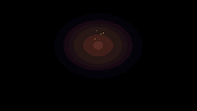
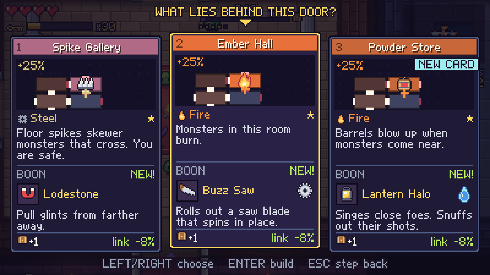
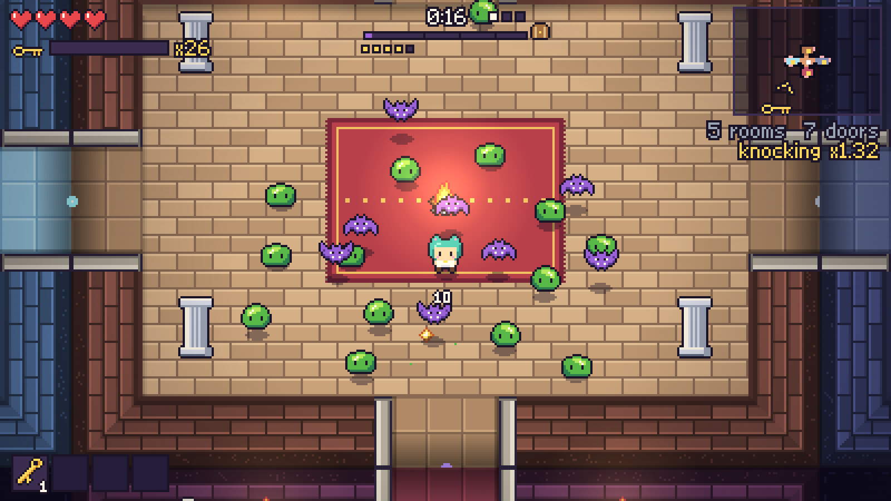

  <picture>
    <source media="(prefers-color-scheme: dark)" srcset=".github/logo-dark.svg">
    <source media="(prefers-color-scheme: light)" srcset=".github/logo-light.svg">
    
  </picture>
  <h1>Roomwright</h1>
  
A survivors-like where every level-up is a room. You draft the dungeon one door at a time.

[![Play in your browser][play-shield]][play-url]
[![License: MIT][license-shield]][license-url]
[![Version 0.2][version-shield]][version-url]
[![One HTML file][file-shield]][file-url]
[![No libraries][libs-shield]][libs-url]
[![Intro made with pixel-cat][film-shield]][film-url]

  <a href="https://pyros-projects.github.io/roomwright/">Play</a> &middot;
  <a href="#the-idea">The idea</a> &middot;
  <a href="#controls">Controls</a> &middot;
  <a href="docs/design.md">How it plays</a> &middot;
  <a href="docs/intro.md">The intro</a> &middot;
  <a href="docs/development.md">Working on it</a> &middot;
  <a href="https://github.com/pyros-projects/roomwright/issues/new">Report Bug</a>

 

---

[Watch the intro with sound](intro.mp4) · [Play Roomwright](https://pyros-projects.github.io/roomwright/)

| A door, three cards | The first room, a minute in |
| :---: | :---: |
|  |  |

## The idea

You start in a single room with four sealed doors. Monsters only ever enter through sealed doors.
Killing them drops glints; glints forge **keys**. Push a key into a door and you *draft* what lies
behind it. Each card is a room (with a persistent power: spikes, guardian owls, a healing fountain,
burning or freezing floors...), a boon (a weapon, an upgrade or a charm) and some number of new doors.

So one choice decides three things at once: how your character grows, what the terrain you fight on
does, and where the next monsters will come from.

Version 0.2 has three floors, 36 room cards, 24 weapons (each with an evolution), 27 charms, four
delvers and a deck you build between runs. [How it plays](docs/design.md) covers stars, elements and
resonance, evolutions, door pressure, pests, the three floors, the deck and the delvers.

## Play

Play at <https://pyros-projects.github.io/roomwright/>, or clone this repository and open `index.html` in a
browser. The game is one self-contained file with no libraries: code draws all in-game pixel art at
boot, and WebAudio synthesises all in-game sound. `intro.mp4`, a 30-second intro film, sits next to
it and is optional. Without it the game starts on the title screen.

## Controls

| | Keyboard and mouse | Gamepad | Touch |
|---|---|---|---|
| Move | WASD / arrows, or hold the left mouse button and drag | left stick / d-pad | drag on the left half |
| Dash (brief invulnerability) | Space / Shift, or right-click | A or X | tap the right half |
| Open a door | walk into it while holding a key | same | same |
| Choose a card | Left/Right + Enter, or 1 2 3 4, or click | stick + A | tap the card |
| The Stairwell (once offered) | Down, then Enter | down + A | tap its bar |
| Deal again (Map Room, two stars) | R | | |
| Knock back: new cards behind this door, at a price | R | | tap KNOCK BACK |
| Step back from a draft (free; cards stay) | Esc | B | tap outside the cards |
| Explain the selected card (in a draft) | H or ? | | tap EXPLAIN |
| Edit the deck (hero screen) | Q or Tab | | tap the deck |
| Pause / options | P or Esc | Start | pause button |
| Mute | M | | |
| Skip the intro | Enter, Space or Esc, or click | A or B | tap |
| Watch the intro again (title screen) | I, or click INTRO | | tap INTRO |

The first draft walks you through a card: the room, the boon, the doors and the Stairwell. Later drafts
explain one new thing each, the first time a card shows it. Weapons fire on their own. `index.html?seed=123` pins the run's random seed. Progress is saved in
`localStorage` under `roomwright.v2`.

## The intro

Every boot plays a 30-second film before the title screen. Enter, Space, Esc, a click or a tap skips
it. An image model painted its eight shots from a model sheet of the game's own sprites, and
[pixel-cat](https://github.com/pyros-projects/pixel-cat) turned the paintings into pixel art and
rendered the film. [The intro film](docs/intro.md) explains how it runs in the game and how to build it.

## Docs

- [How it plays](docs/design.md): the floor plan, the three floors, the deck, the delvers and where each weapon evolves.
- [The intro film](docs/intro.md): what the game does with it, and the four steps that build it.
- [Working on it](docs/development.md): the build, the source map, where to change things, the live copy and what is not done yet.
- [Checks, debug hooks and self-play](docs/checks.md): the regression pass, the test hooks and the bot's win rates.

## License

[MIT](LICENSE)

[play-shield]: https://img.shields.io/badge/play-in%20your%20browser-F6923A?style=flat-square
[play-url]: https://pyros-projects.github.io/roomwright/
[license-shield]: https://img.shields.io/badge/License-MIT-green?style=flat-square
[license-url]: LICENSE
[version-shield]: https://img.shields.io/badge/version-0.2-30343B?style=flat-square
[version-url]: #the-idea
[file-shield]: https://img.shields.io/badge/one-HTML%20file-3FC1AD?style=flat-square
[file-url]: index.html
[libs-shield]: https://img.shields.io/badge/libraries-none-30343B?style=flat-square
[libs-url]: docs/development.md
[film-shield]: https://img.shields.io/badge/intro-made%20with%20pixel--cat-F08A3C?style=flat-square
[film-url]: https://github.com/pyros-projects/pixel-cat
