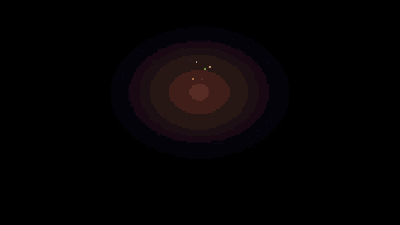

# The intro film

[Back to the README](../README.md)

[](../intro.mp4)

[Watch it with sound](../intro.mp4)

## In the game

Every time the game boots, it plays `intro.mp4` before the title screen: one room and four sealed
doors, the knocking, glints forging a key, the key in the lock, a new room, the Warden, the floor
plan growing, the logo. The film ends on the logo where the title screen draws it, and the title
fades in under it. A browser only starts a film with sound after a key press or a tap, so the game
shows `PRESS ANY KEY` first. Enter, Space, Esc, a click or a tap skips the film. The game stores
nothing about it, so the next boot plays it again. On the title, `I` (or the INTRO label in the
corner) plays it once more. `M` mutes it like everything else. `index.html?intro=0` starts on the
title.

`src/61-intro.js` is the player: a `<video>` laid over the canvas, the skip label drawn in the
game's font, and the fallbacks (no file, no codec, a stalled download) that lead to the title.

## How it was built

The film's sources are in `intro/`. [pixel-cat](https://github.com/pyros-projects/pixel-cat) converts
the art and renders the film:

1. `intro/art/prompts/` holds one prompt per shot. An image model painted each shot at 1792 x 1008,
   steered by a model sheet made from the game's own sprites (`intro/art/raw/00-model-sheet.png`)
   and a screenshot. `intro/tools/imagegen.py` makes the calls. The paintings are in `intro/art/raw/`.
2. `pixel-cat convert` turns each painting into a 400 x 225 plate with 64 colours (`intro/plates/`).
   `intro/build.sh --plates` also cuts the key and the glint from the model sheet and converts them
   (`intro/sprites/`). The game draws the logo, the tagline and the captions itself, and
   `intro/tools/export_text.py` exports them, so the film's lettering is the game's lettering.
3. `intro/make_story.py` writes `story.json`: eight shots with camera moves, lights, particles and
   sprite layers. Its soundtrack plays the title theme (Am F C G at 80 bpm) on the film skill's
   bells and tones. The cues repeat the notes of the game's knock, key and draft sounds. Cuts fall
   on beats. The captions are in `intro/captions.json`.
4. `intro/build.sh` renders `story.json` with pixel-cat's film renderer, burns the captions in and
   writes `intro.mp4` (1600 x 900, H.264 and AAC, under 5 MB).

```
intro/build.sh            # needs uv, ffmpeg and a pixel-cat checkout (PIXEL_CAT_HOME)
intro/build.sh --plates   # also convert the paintings again
```
